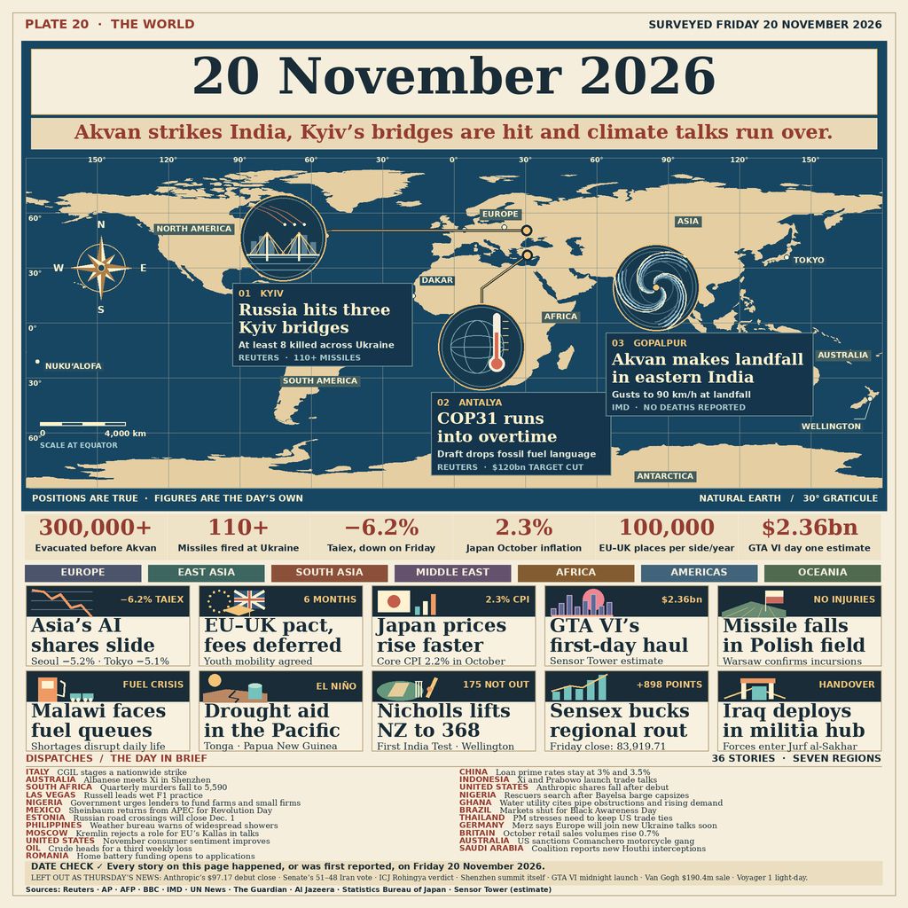

# The Atlas Plate

A world news survey for Friday 20 November 2026. Three illustrated map pins lead into 10 illustrated stories and 23 dispatches across seven regions. See the [source ledger](SOURCES.md) for the reporting dates and figures.

Run with `MAKEFUN_OUTPUT_DIR=out python3 -P -s main.py`. The runner copies the finished image with the standard library.

To rebuild, install Pillow and the DejaVu Serif and Sans fonts, then run `python3 render.py`. The renderer fetches and verifies the pinned Natural Earth land geometry, draws at 2048 × 2048, and downsamples to a 1024 × 1024 RGB PNG. The runner needs neither Pillow nor network access.
